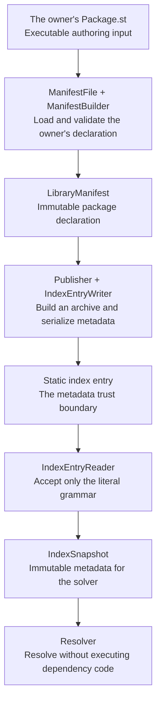

# Parley — Design Rationale

Parley is a native package manager for GNU Smalltalk 3.2.5, written entirely in Smalltalk. The binding rules live in [architecture.md](architecture.md) and the component design docs; this document explains *why* those rules exist, so contributors apply them with judgment rather than compliance.

## The trust boundary in one picture

The author chooses to execute their own manifest. Publication turns its declared
package data into static metadata, which a consumer reads without evaluating the
producer's manifest. Archive verification is a later integrity check; it does not
make installed package code safe to execute.

A local path dependency is an explicit authoring choice: its sibling manifest is
read through the same authoring boundary. It is not a registry entry silently
evaluated during solving. See [decisions 2–5](architecture.md#decision-2) and
[decision 68](architecture.md#decision-68).

**Why the moat matters.** Parley is both a tool and a demonstration: its codebase is the flagship example for a content series about what software looks like when live objects, message passing, and refactor-as-you-think are taken seriously. A working package manager built as procedural glue would succeed as a tool and fail as the project. That is why every pipeline concept — a version, a constraint, a source, a conflict, an execution scope — is an independent object answering messages, and why branching on the kind of a thing is always replaced by polymorphism.

**Why process-level sandboxing, not image namespaces.** GNU Smalltalk 3.2.5's namespace system cannot host two versions of the same class in one live image — this is a platform property, not a missing feature we could engineer around. Attempting in-image version isolation is the single most likely way for this project to stall for months. So Parley translates Ruby's `bundle exec` honestly: `ExecutionScope` launches a clean child `gst` process whose curated package path makes only the exact resolved set visible. The sandbox is a domain object that composes process invocations, not an in-image illusion.

**Why we never intersect anonymously.** A resolver that stores bare constraints loses the answer to "why?" the moment an intersection comes back empty — forcing explanation logic to be reconstructed during backtracking, which pollutes the search algorithm. `ConstraintLedger` therefore never stores a constraint without the `Term`s that imposed it. When an intersection collapses, the contributors are already in hand and the `Incompatibility` builds itself from data the ledger was keeping anyway. Explanations are an emergent property of the data structures; the search loop stays free of explanation branches. This is also deliberate groundwork: these `Term`/`Incompatibility` objects are exactly the clauses a future PubGrub solver consumes, so upgrading the algorithm later swaps the loop, not the domain.

**Why constraints are a normal form, not a subclass hierarchy.** Modeling `ExactConstraint`/`RangeConstraint`/`UnionConstraint` as classes looks idiomatic but creates an N×N double-dispatch matrix for `intersect:`/`union:` and makes equality undecidable without normalization anyway (`(>=1.0 <2.0) ∪ (>=2.0)` must equal `>=1.0`). Since a canonical form is required regardless, the subclasses carry no information: a `VersionConstraint` is a sorted array of disjoint, non-adjacent `VersionRange`s, an exact pin is the degenerate range `[v,v]`, and equality is element-wise. `complement` exists from day one because PubGrub's negative terms are complements.

**Why the manifest/metadata split.** Executable `Package.st` manifests give Elixir-Mix ergonomics, but resolving against executable files would mean running third-party code to compute a dependency graph — the mistake Cargo's static TOML deliberately avoids. Parley takes both: authors write live Smalltalk against a restricted `ManifestBuilder` (a vocabulary and validator, NOT a security sandbox — authors own their own files), and publishing serializes to a static index entry. The static entry is the actual security boundary: the resolver consumes only static metadata, and no third-party content ever touches the compiler — not even literal arrays, which is why the literal micro-format has its own ~50-line reader instead of `Behavior>>evaluate:`. (3.2.5 also has no STON, and the self-contained-domain rule forbids porting one.)

**Why the DSL vocabulary is explicit methods, with `doesNotUnderstand:` as error path only.** A DNU-based DSL is invisible to tooling: senders, implementors, completion, and hover documentation all work by finding real method definitions. The manifest vocabulary is API surface and must be browsable; DNU's one job is turning typos into rich, inspectable `ManifestVocabularyError`s whose "known messages" list is reflected from the vocabulary category so it can never drift.

**Why values, not exceptions; why copy-on-descend.** Resolution answers a `Resolution` or a `ConflictReport` — never hot-loop exceptions — because the resolver is a pure function of (manifest, immutable snapshot), and pure functions returning values are trivially testable and deterministic. The same immutability makes backtracking cheap: each recursion level gets its own ledger copy sharing immutable accumulation values, so backtracking is literally returning from a method. No undo logs.

**Why Cargo-exact caret and no prereleases.** `^0.2.3 → [0.2.3, 0.3.0)` matches how pre-1.0 software actually versions (this rule was introduced before Parley's own 1.0 release). Prerelease ordering is a bug farm deferred *whole* — `Version` rejects prerelease tags with a clear error rather than half-supporting them.

**Why byte-stable serialization and day-one lockfiles.** Determinism is a shipped product feature, not an aspiration: fixed key order, sorted dependencies, canonical constraint strings, and a format tag make index entries and lockfiles hash-stable and diff-friendly, and make "same inputs ⇒ byte-identical lockfile" a testable law. One asymmetry is deliberate: `fileIns` order is *preserved* (it is `gst-package` load order — semantic in Smalltalk) while dependencies are *sorted* (their order is meaningless). Do not "fix" either.

**Why axiomatic tests.** `VersionConstraint` is the keystone everything leans on, and set algebra has the rare property of being checkable against mathematical laws (De Morgan, absorption, double complement, membership consistency) over randomized inputs with a deterministic seed. Bound-inclusivity off-by-ones — this domain's classic bug — are caught by laws, not hand-picked examples.

**Why sparse fetches finish before solving.** Fetching metadata lazily from inside
the search would make the answer depend on network timing and on which branches
the solver happened to visit. Instead, the source gathers the reachable metadata
closure once, seeded by the caller's manifest and lock context, and then seals a
snapshot. The solver can backtrack over the same immutable world as often as it
needs. This keeps sparse transport useful without making I/O part of resolution
([decisions 50–51](architecture.md#decision-50)).

**Why local development is a source overlay.** A sibling checkout should win over
an index release while its author edits it. That changes which candidates are
available, not what compatibility means. The overlay supplies the sibling's
current declaration to resolution, while index reports continue describing what
the index actually publishes. Path provenance in the lock distinguishes this
editable input from a hash-pinned archive, and root-only development declarations
stay out of published entries ([decisions 68–69](architecture.md#decision-68)).

**Why manifest edits recognize or refuse.** An executable manifest can contain
comments, expressions and formatting that its resulting package object cannot
remember. Serializing that object back over the file would silently discard the
author's work. `add` and `remove` therefore edit only a recognized textual shape,
re-read the result, and restore the original when the requested edit cannot be
completed safely. Refusing an unfamiliar file is preferable to claiming a
lossless round-trip that the model cannot provide
([decisions 49 and 67](architecture.md#decision-49)).

**Why argument preservation and script success are separate promises.** A path
that contains a space must reach the child as one argument; otherwise a checked
script can disappear at the shell boundary. Encoding the complete argument at
each composer fixes that transport problem without changing the single process
seam. It cannot change GNU Smalltalk 3.2.5's treatment of an unhandled script
error: the child may still exit zero. Scripts used as CI checks must choose their
exit status explicitly, and downstream filename/XML restrictions remain their
own boundary ([decision 91](architecture.md#decision-91),
[decision 45](architecture.md#decision-45)).

When a design question is not answered by these documents, open a discussion before improvising. Do not invent architecture.
